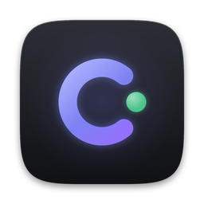
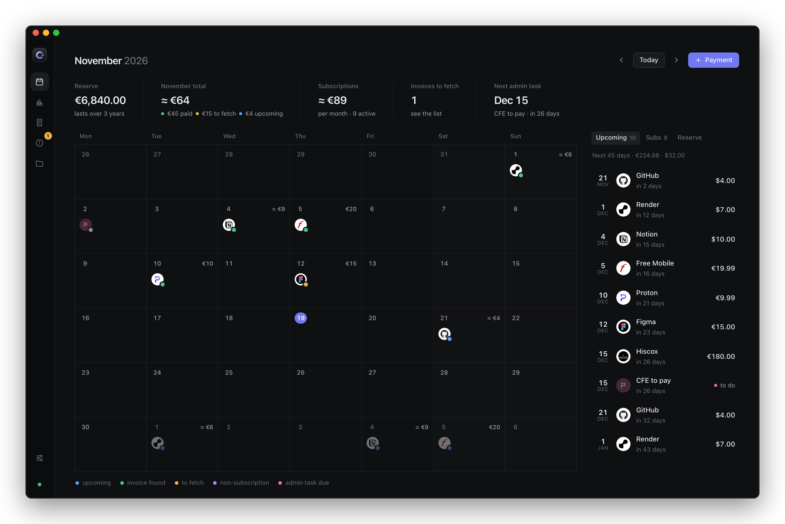
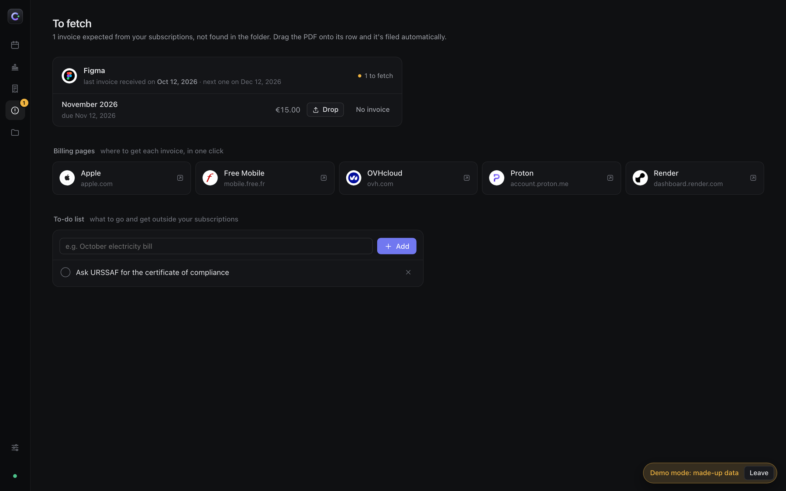
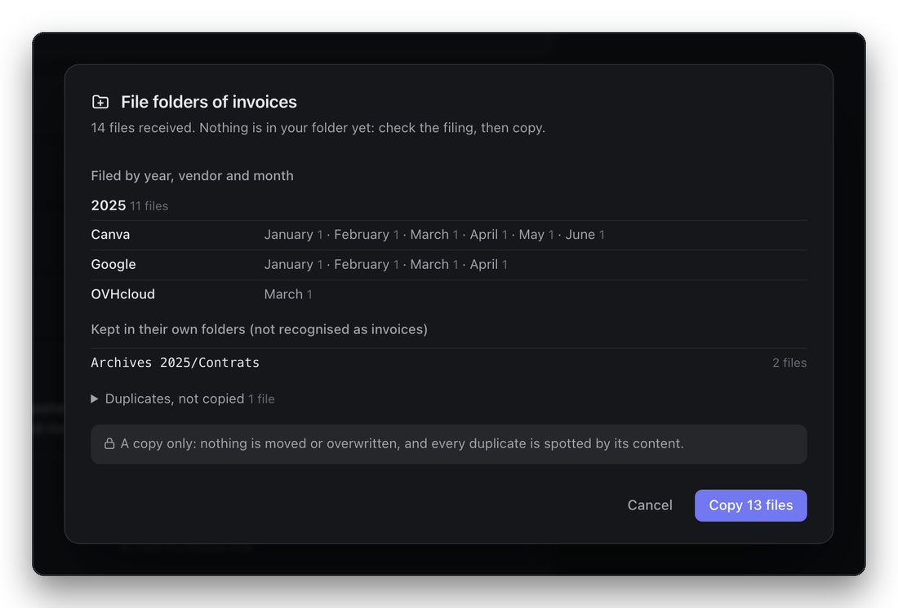
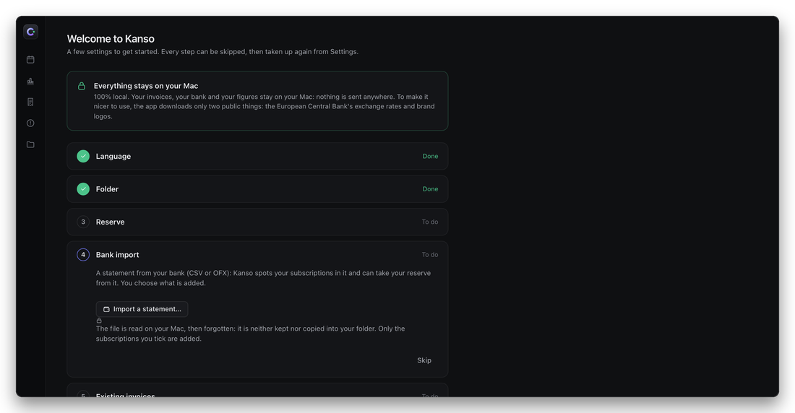

<div align="center">



# Kanso

**Your micro-business's subscriptions, invoices and paperwork, together on your Mac.**

[](https://github.com/Coddyum/kanso/actions/workflows/ci.yml)
[](LICENSE)
[](#install)
[](docs/ARCHITECTURE.md)
[](#privacy)

[Install](#install) · [Features](#features) · [Privacy](#privacy) · [Architecture](docs/ARCHITECTURE.md) · [Français](README.md)

</div>

> **100% local.** Your invoices, your bank and your figures stay on your Mac: nothing is sent anywhere. To be more pleasant, the app downloads only two public things: the European Central Bank's exchange rates and the brands' logos.

<p align="center">
  
</p>

## Why Kanso

Kanso (簡素, "simplicity") keeps track of what a micro-business pays: subscriptions, purchases, URSSAF,
CFE, income tax. Your invoices folder stays the reference: Kanso reads it, files into it and tells you
what is missing. No account, no subscription, no remote server.

- **Your folder is the only source.** What you file in the Finder shows up in the app within seconds;
  what you drop into the app is filed in `Year/Vendor/Month`.
- **Nothing to type twice.** Vendor, date, amount and currency are read in every invoice, even a scanned
  one; subscriptions are worked out from your invoices or your bank statement.
- **Nothing leaves.** A local server that only listens to your Mac, and a native Mac app for the window
  and the reminders.

## Features

<table>
  <tr>
    <td width="50%" valign="top">
      
      <p><strong>Analytics</strong><br>Spending by month, by project and by service, converted to euros at the ECB's rates.</p>
    </td>
    <td width="50%" valign="top">
      
      <p><strong>Invoices that read themselves</strong><br>Vendor, date, amount and number, even from a scan or a photo of a receipt, read by Apple's Vision on your Mac.</p>
    </td>
  </tr>
  <tr>
    <td width="50%" valign="top">
      
      <p><strong>Missing invoices</strong><br>Every past due date with no invoice, with a link to the vendor's billing page. Drop the PDF: it is filed in the right place.</p>
    </td>
    <td width="50%" valign="top">
      
      <p><strong>Your old folders, filed</strong><br>Drag whole folders in: copied only, duplicates spotted, filing previewed before anything is written, undone in one click.</p>
    </td>
  </tr>
</table>

| | |
| --- | --- |
| **Bank import** | A CSV or OFX statement from any bank: columns recognised, balance taken as the reserve, recurring debits suggested as subscriptions. The file is forgotten as soon as it is read. |
| **Reserve** | The business account's balance day by day, upcoming payments included, with an alert before it runs out. |
| **Paperwork** | URSSAF declarations (monthly or quarterly), CFE, income tax return: in the calendar, ticked off once done. |
| **Reminders** | macOS notifications the day before a payment, before a deadline, when an invoice is missing, even with the app closed. |
| **Downloads** | Optional: an invoice arriving in Downloads brings a notification "file it?". |
| **Six languages** | French, English, Spanish, Japanese, Chinese and Arabic, with a right-to-left interface. |
| **Demo mode** | Made-up data to try it without touching your folder. Every screenshot on this page comes from it. |

## Install

| Requirement | |
| --- | --- |
| macOS | 13 Ventura or later |
| Apple's command line tools | `xcode-select --install` |
| Go | the version in `go.mod`, or later: [go.dev/dl](https://go.dev/dl/) |

```bash
git clone https://github.com/Coddyum/kanso.git
cd kanso
./install.sh
```

The install builds the app on your Mac, with no Homebrew and no other dependency, then opens it on the
getting-started list: language, folder, reserve, bank import, existing invoices, notifications,
Downloads. Every step can be skipped and taken up again later from Settings.

<p align="center">
  
</p>

<details>
<summary>What <code>install.sh</code> does, step by step</summary>

1. Checks the macOS version, Apple's tools and Go. It downloads nothing: when something is missing, it
   says where to get it and stops.
2. Builds `bin/kanso`, its launcher and the document-reading helper (`make build`).
3. Builds `Kanso.app` and installs it in `~/Applications` (`make app`).
4. Runs `kanso init`: asks for the name or the path of your invoices folder (`~/Documents/Invoices` by
   default), creates it if needed, sets up the automatic start with your Mac and opens the app. macOS
   asks once for access to the Documents folder.

</details>

Update or uninstall:

```bash
./bin/kanso update      # git pull, build; the app restarts by itself
./bin/kanso uninstall   # removes the app, the automatic start and the cache; your folder stays untouched
```

## Commands

| Command | What it does |
| --- | --- |
| `kanso init` | choose the invoices folder and have Kanso start with your Mac |
| `kanso update` | get the latest version and build it |
| `kanso doctor` | check the install, one line per point, with what to do when something is wrong |
| `kanso demo` | open a demo with made-up data on its own port, without touching your folder |
| `kanso uninstall` | remove Kanso from the Mac; your folder and your data stay |
| `kanso version` | print the version |

Everything else is set in the app, on the Settings screen.

## Privacy

| Stays on your Mac | May be downloaded (each with its switch, in Settings › Privacy) |
| --- | --- |
| Your invoices, bank statements, amounts, subscriptions and settings | The day's exchange rates, from the European Central Bank's site |
| The text read in your documents (PDFKit and Vision, on the Mac) | The logo of a vendor in your data, from the brand's own site |

- **One single way out.** Every network access goes through `internal/netgate`, which allows only those
  two destinations. A test fails when any other network call appears in the server, the page or the Mac app.
- **A server closed to others.** It only listens on `127.0.0.1`, refuses requests from other websites
  and any write without its own header.
- **The bank statement is never kept**: it is read in memory, then forgotten.
- **Downloads is never read without your consent**: the watch is off by default, and macOS asks for
  permission.

| Where your data is | |
| --- | --- |
| Invoices | your folder, filed in `Year/Vendor/Month` |
| Database, backups (30 days), corrections | your folder's hidden `.kanso` subfolder |
| Settings | `~/Library/Application Support/Kanso` |
| Cache (PDF texts, logos, rates) | `~/Library/Caches/kanso`, safe to delete |

## Languages

| Language | Status |
| --- | --- |
| Français | reference language |
| English, Español, 日本語, 中文, العربية | complete; reviews by native speakers welcome |

The paperwork stays that of a French micro-business, whatever the language. Every text is in
`web/locales/<language>.json`: a translation fix is a valuable contribution.

## FAQ

<details>
<summary>Do I need an account?</summary>

No. There is no account, no remote server and no subscription: everything runs on your Mac.
</details>

<details>
<summary>What about Windows or Linux?</summary>

Not for now. Kanso relies on macOS to read documents (PDFKit, Vision), for notifications and for its app.
</details>

<details>
<summary>Does Kanso change my invoices folder?</summary>

Only through what you do in the app: drop, rename, move, file. Nothing is ever overwritten, and an
imported folder of invoices is copied, never moved. Kanso's own data goes into the hidden `.kanso`
subfolder.
</details>

<details>
<summary>And for a business outside France?</summary>

Tracking expenses, invoices and subscriptions works anywhere, in 30 currencies. The paperwork (URSSAF,
CFE, income tax) is that of a French micro-business; it can be turned off in Settings.
</details>

## Contributing

Contributions are welcome, translation reviews above all. The guide is in
[CONTRIBUTING.md](CONTRIBUTING.md); the architecture in [docs/ARCHITECTURE.md](docs/ARCHITECTURE.md).
Security issues are reported privately: see [SECURITY.md](SECURITY.md). Everyone taking part follows the
[code of conduct](CODE_OF_CONDUCT.md).

## License

Released under the [GNU AGPL-3.0](LICENSE).
