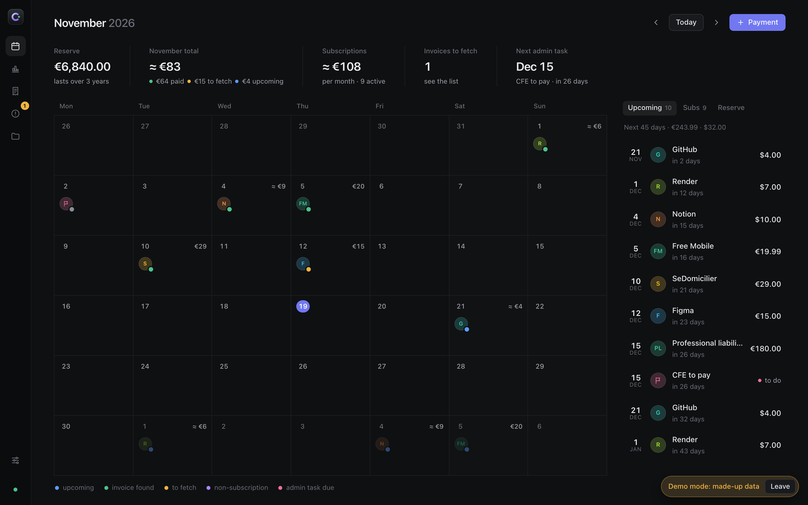
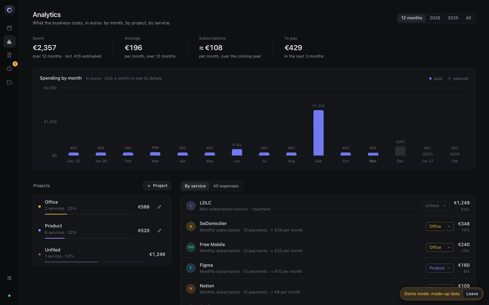
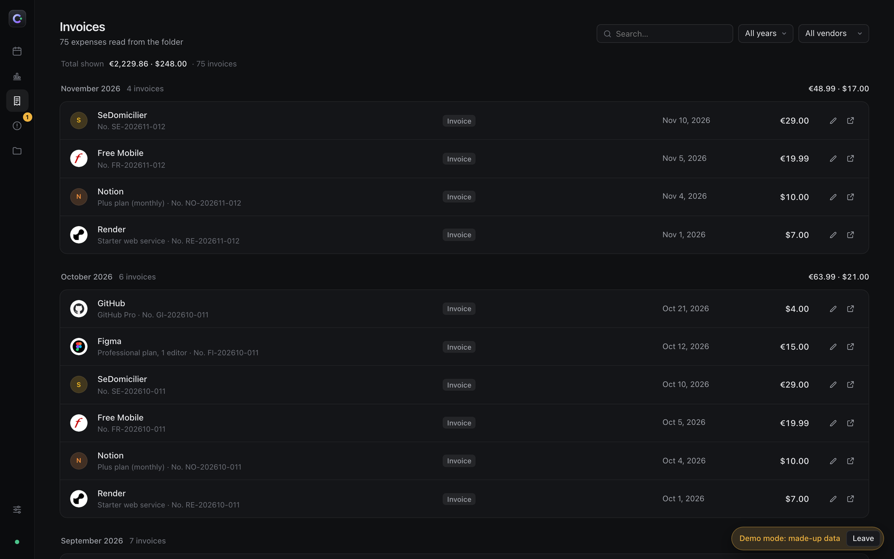

# 100% local. Your invoices, your bank and your figures stay on your Mac: nothing is sent anywhere. To be more pleasant, the app downloads only two public things: the European Central Bank's exchange rates and the brands' logos.

**Kanso** (簡素, "simplicity") follows a French micro-business's expenses on a Mac: the subscriptions and
upcoming payments, the invoices already filed in a folder, the missing ones, the business account's
reserve and the paperwork (URSSAF, CFE, income tax).

[Version française](README.md)



## What the app does

Your invoices folder stays the truth: what you file in the Finder shows up in the app within seconds, and
what you drop into the app is filed in the folder, in `Year/Vendor/Month`.

| Screen | What it shows |
| --- | --- |
| Calendar | the due dates of your subscriptions and planned payments, the invoices found, the month's total, the reserve day by day |
| Analytics | spending in euros by month, by project and by service; amounts in other currencies are converted at the ECB's rates |
| Invoices | every invoice read in the folder: vendor, date, amount, number; an invoice and its receipt make one line |
| Missing | each past due date with no invoice; drop the PDF on its card and it is filed in the right place |
| Folder | the folder as it is: create, drop, rename, move |
| Settings | language, folder, paperwork, notifications, privacy, data (export, backups, diagnostic) |



- **Getting started**: on first launch, a checklist (language, folder, reserve, bank import, existing
  invoices, notifications, Downloads); every step can be skipped and taken up again from Settings.
- **Bank import**: a CSV or OFX statement from any bank. Its columns are recognised (otherwise you say
  which one is the date, the description, the amount), a balance column fills the reserve, and the
  debits that come back become suggested subscriptions. The file is read in memory, then forgotten.
- **Folders of invoices kept elsewhere**: drag them into the app. It copies them (never moves or
  overwrites anything), spots duplicates by their content, shows the filing before writing, and the copy
  can be undone with one button.
- **Downloads** (off by default): an invoice arriving in Downloads brings a notification "invoice X
  found, file it?".
- **Scans and photos of receipts**: read by Vision, Apple's text recognition, on your Mac.
- **Reminders**: the Mac app schedules macOS notifications — the day before a payment, before a
  deadline, when invoices are missing, before the reserve runs out —, even with the app closed.
- **Demo mode**: Settings › Getting started › "Try it with made-up data". Every screenshot on this page
  comes from it.



## Install

You need a Mac on macOS 13 or later, Apple's command line tools (`xcode-select --install`) and
[Go](https://go.dev/dl/) in the version `go.mod` names, or a later one. No Homebrew, no other dependency:
the app is built on your Mac.

```bash
git clone https://github.com/Coddyum/kanso.git
cd kanso
./install.sh
```

`install.sh` checks macOS, Apple's tools and Go (it downloads nothing: when something is missing, it says
where to get it), builds, installs `Kanso.app` in `~/Applications`, then runs `kanso init`: it asks for
the name or the path of your invoices folder (`~/Documents/Invoices` by default), creates it if needed,
sets up the automatic start and opens the app on the getting-started list. macOS asks once for access to
the Documents folder.


## Commands

```bash
./bin/kanso init        # choose the folder and have Kanso start with your Mac
./bin/kanso update      # get the latest version (git pull) and build it
./bin/kanso doctor      # check that everything works, one line per point
./bin/kanso uninstall   # remove Kanso from the Mac; your folder and your data stay
./bin/kanso demo        # a demo with made-up data on its own port, without touching your folder
./bin/kanso version
```

Everything else is set in the app (Settings).

## Privacy

- **Everything stays on your Mac.** The server only listens on `127.0.0.1`; your invoices, your bank
  statement and your figures never leave it.
- **Only two public downloads**, each with its switch in Settings › Privacy: the ECB's exchange rates,
  and a brand's logo, taken from the brand's own site (never a third-party icon service), only for a
  vendor of your data.
- **One single way out in the code** (`internal/netgate`) and a test that fails when any other network
  call appears, in the server, the page or the Mac app.
- **The bank statement** is read in memory and forgotten: neither kept nor copied into your folder.
- **Downloads** is never read without your consent: the watch is off by default, and macOS asks for
  permission.
- **Where the data is**: your folder (the invoices) and its hidden `.kanso` subfolder (the `db.json`
  database, its backups of the last 30 days, your corrections); the settings in
  `~/Library/Application Support/Kanso`; the cache (PDF texts, logos, rates) in `~/Library/Caches/kanso`,
  safe to delete.

## Languages

The app speaks French, English, Spanish, Japanese, Chinese and Arabic (right-to-left interface). The
paperwork stays that of a French micro-business, whatever the language.

> **Native speakers wanted.** The English, Spanish, Japanese, Chinese and Arabic translations have not
> been reviewed by native speakers yet. Corrections are welcome: every text is in
> `web/locales/<language>.json`.

## Contributing

```bash
git config core.hooksPath .githooks   # install.sh does it for you
make test                             # gofmt, go vet, go test -race
```

- **No personal data in the repository.** The commit hook runs `tools/privacy`, which refuses PDFs,
  CSVs, OFX files, photos and databases, as well as IBANs, e-mail addresses, phone numbers, SIRET numbers
  and paths of a home folder. `go run ./tools/privacy -all` reviews the whole repository.
- **Every visible text goes through `web/locales`.** `fr.json` is the reference; the other languages have
  exactly the same keys. The `internal/i18n` test refuses a missing key, an unused key, or a text written
  in the page, the server or the Mac app.
- **The network goes through `internal/netgate`**, or its test fails.
- Go, standard library only; the page with no framework and no build step. The architecture is described
  in [docs/ARCHITECTURE.md](docs/ARCHITECTURE.md).

## License

[AGPL-3.0](LICENSE).
