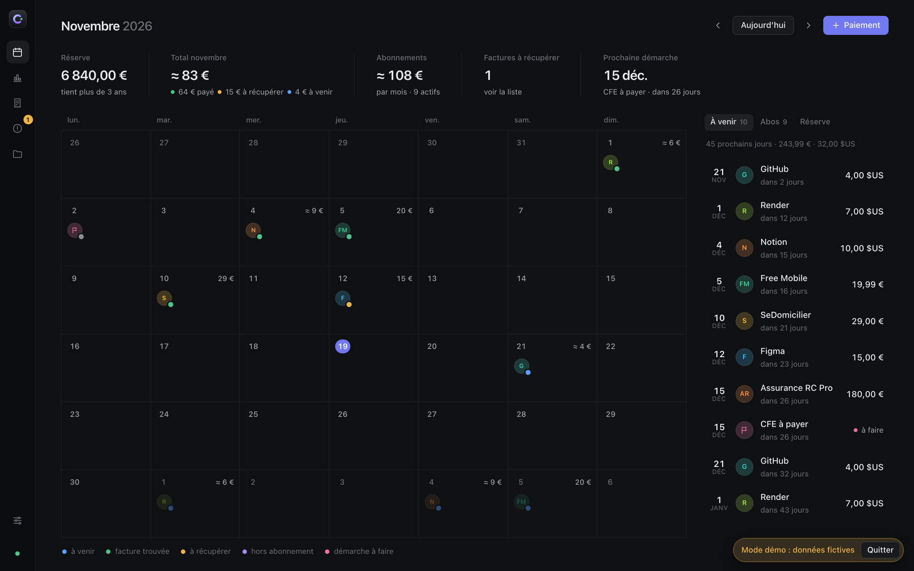
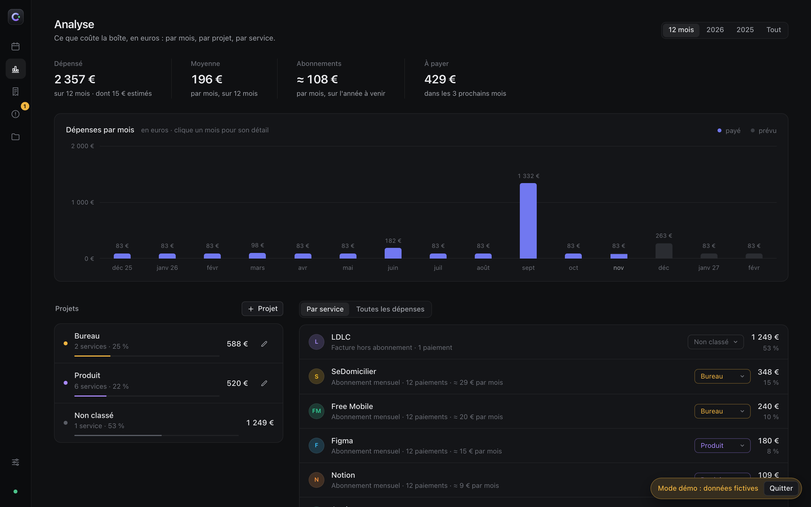
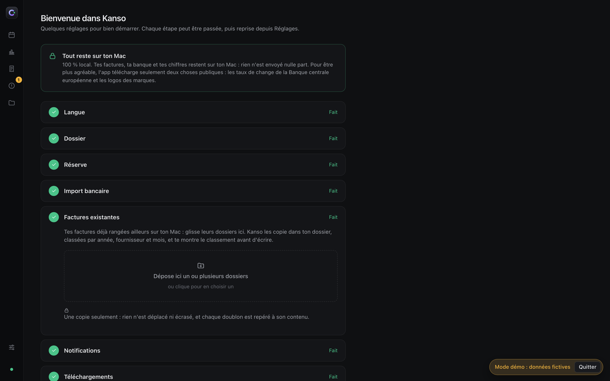

# 100 % local. Tes factures, ta banque et tes chiffres restent sur ton Mac : rien n'est envoyé nulle part. Pour être plus agréable, l'app télécharge seulement deux choses publiques : les taux de change de la Banque centrale européenne et les logos des marques.

**Kanso** (簡素, « sobriété ») suit les dépenses d'une micro-entreprise sur Mac : les abonnements et
paiements à venir, les factures déjà rangées dans un dossier, celles qui manquent, la réserve du compte
pro et les démarches (URSSAF, CFE, impôt sur le revenu).

[English version](README.en.md)



## Ce que fait l'app

Ton dossier de factures reste la vérité : ce que tu ranges dans le Finder apparaît dans l'app en quelques
secondes, et ce que tu déposes dans l'app est rangé dans le dossier, dans `Année/Fournisseur/Mois`.

| Écran | Ce qu'il montre |
| --- | --- |
| Calendrier | les échéances de tes abonnements et paiements prévus, les factures trouvées, le total du mois, la réserve jour après jour |
| Analyse | les dépenses en euros par mois, par projet et par service ; les montants en devises sont convertis aux taux de la BCE |
| Factures | toutes les factures lues dans le dossier : fournisseur, date, montant, numéro ; facture + reçu = une seule ligne |
| À récupérer | chaque échéance passée sans facture ; dépose le PDF sur la carte, il est rangé au bon endroit |
| Dossier | le dossier tel quel : créer, déposer, renommer, déplacer |
| Réglages | langue, dossier, démarches, notifications, confidentialité, données (export, sauvegardes, diagnostic) |



- **Premiers pas** : au premier lancement, une liste à cocher (langue, dossier, réserve, import bancaire,
  factures existantes, notifications, Téléchargements) ; chaque étape se passe et se reprend depuis
  Réglages.
- **Import bancaire** : un relevé CSV ou OFX de n'importe quelle banque. Les colonnes sont reconnues
  (sinon tu dis laquelle est la date, le libellé, le montant), la colonne solde remplit la réserve, et
  les prélèvements réguliers deviennent des abonnements proposés. Le fichier est lu en mémoire puis oublié.
- **Dossiers de factures déjà rangés ailleurs** : glisse-les dans l'app. Elle les copie (jamais de
  déplacement ni d'écrasement), repère les doublons à leur contenu, montre le classement avant d'écrire,
  et la copie s'annule d'un bouton.
- **Téléchargements** (désactivé par défaut) : une facture qui arrive dans Téléchargements donne une
  notification « facture X détectée, la ranger ? ».
- **Scans et photos de tickets** : lus par Vision, la reconnaissance de texte d'Apple, sur ton Mac.
- **Rappels** : l'app Mac programme des notifications macOS — la veille d'un paiement, avant une
  démarche, quand il manque des factures, avant que la réserve tombe à zéro —, même app fermée.
- **Mode démo** : Réglages › Premiers pas › « Essayer avec des données fictives ». Toutes les captures
  de cette page viennent de là.


## Installation

Il faut un Mac sous macOS 13 ou plus récent, les outils en ligne de commande d'Apple
(`xcode-select --install`) et [Go](https://go.dev/dl/) dans la version indiquée par `go.mod` ou plus
récente. Pas de Homebrew, pas d'autre dépendance : l'app est compilée sur ton Mac.

```bash
git clone https://github.com/Coddyum/kanso.git
cd kanso
./install.sh
```

`install.sh` vérifie macOS, les outils d'Apple et Go (il ne télécharge rien : s'il manque quelque
chose, il dit où le prendre), compile, installe l'app `Kanso.app` dans `~/Applications`, puis lance
`kanso init` : il te demande le nom ou le chemin de ton dossier de factures (`~/Documents/Factures` par
défaut), le crée s'il n'existe pas, installe le lancement automatique et ouvre l'app sur les premiers pas.
macOS demande une fois l'accès au dossier Documents.



## Commandes

```bash
./bin/kanso init        # choisir le dossier et lancer Kanso avec le Mac
./bin/kanso update      # récupérer la dernière version (git pull) et la compiler
./bin/kanso doctor      # vérifier que tout marche, une ligne par point
./bin/kanso uninstall   # retirer Kanso du Mac ; ton dossier et tes données restent
./bin/kanso demo        # une démo aux données fictives sur son propre port, sans toucher à ton dossier
./bin/kanso version
```

Le reste se règle dans l'app (Réglages).

## Confidentialité

- **Tout reste sur ton Mac.** Le serveur n'écoute que sur `127.0.0.1` ; tes factures, ton relevé
  bancaire et tes chiffres ne sortent jamais.
- **Deux téléchargements publics seulement**, chacun avec son interrupteur dans Réglages ›
  Confidentialité : les taux de change de la BCE, et le logo d'une marque, pris sur le site de la marque
  elle-même (jamais un service d'icônes tiers), seulement pour un fournisseur de tes données.
- **Une seule porte de sortie dans le code** (`internal/netgate`) et un test qui casse si un autre appel
  réseau apparaît, dans le serveur, la page ou l'app Mac.
- **Le relevé bancaire** est lu en mémoire et oublié : ni gardé, ni copié dans ton dossier.
- **Téléchargements** n'est jamais lu sans ton accord : la surveillance est éteinte par défaut, et macOS
  demande l'autorisation.
- **Où sont les données** : ton dossier (les factures) et son sous-dossier caché `.kanso` (la base
  `db.json`, ses sauvegardes des 30 derniers jours, tes corrections) ; les réglages dans
  `~/Library/Application Support/Kanso` ; le cache (textes des PDF, logos, taux) dans
  `~/Library/Caches/kanso`, supprimable sans perte.

## Langues

L'app parle français, anglais, espagnol, japonais, chinois et arabe (interface de droite à gauche). Les
règles administratives restent celles d'une micro-entreprise française, quelle que soit la langue.

> **À relire par des locuteurs natifs.** Les traductions anglaise, espagnole, japonaise, chinoise et
> arabe n'ont pas encore été relues par des natifs. Une correction est la bienvenue : chaque texte est
> dans `web/locales/<langue>.json`.

## Contribuer

```bash
git config core.hooksPath .githooks   # install.sh le fait pour toi
make test                             # gofmt, go vet, go test -race
```

- **Aucune donnée personnelle dans le dépôt.** Le hook de commit lance `tools/privacy`, qui refuse les
  PDF, CSV, OFX, photos et bases de données, ainsi que les IBAN, adresses e-mail, téléphones, numéros
  SIRET et chemins de dossier personnel. `go run ./tools/privacy -all` passe tout le dépôt en revue.
- **Chaque texte visible passe par `web/locales`.** `fr.json` est la référence ; les autres langues ont
  exactement les mêmes clés. Le test `internal/i18n` refuse une clé manquante, une clé inutilisée ou un
  texte écrit en dur dans la page, le serveur ou l'app Mac.
- **Le réseau passe par `internal/netgate`**, sinon son test casse.
- Go, bibliothèque standard seulement ; la page sans framework ni étape de build. L'architecture est
  décrite dans [docs/ARCHITECTURE.md](docs/ARCHITECTURE.md).

## Licence

[AGPL-3.0](LICENSE).
