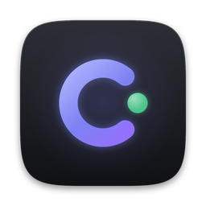
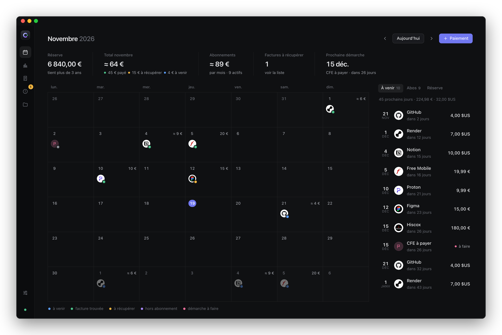
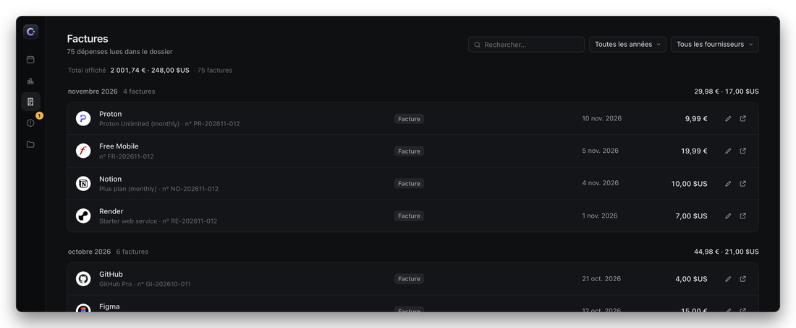
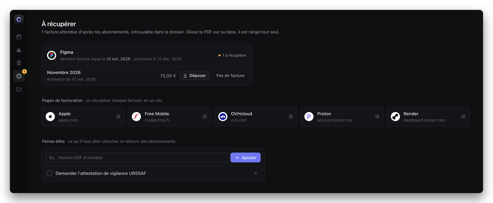
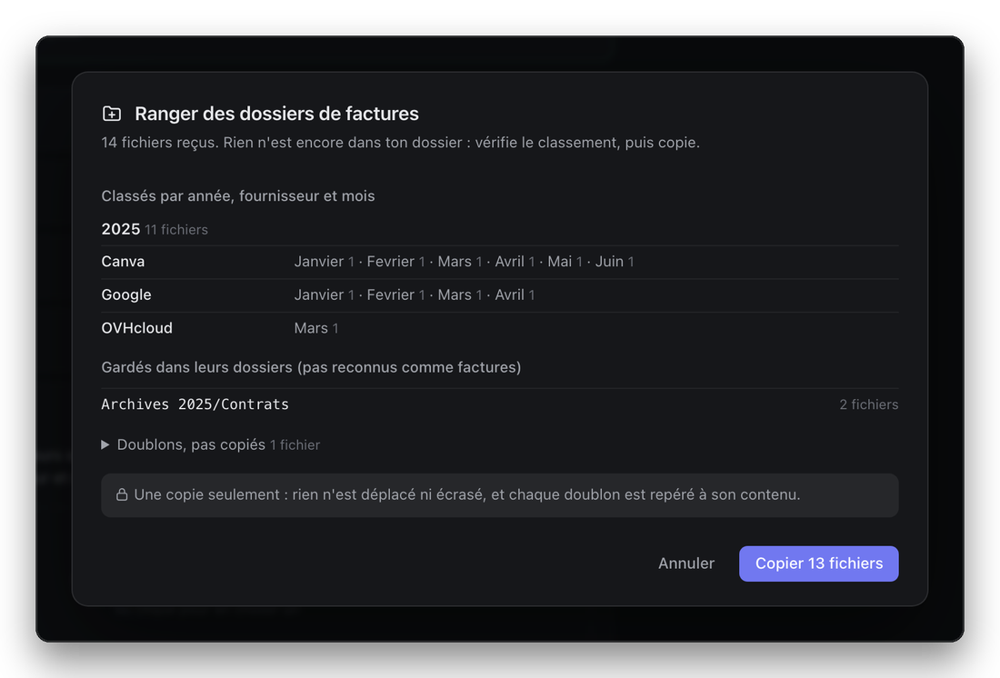

<div align="center">



# Kanso

**Abonnements, factures et démarches de ta micro-entreprise, réunis sur ton Mac.**

[](LICENSE)
[](#installation)
[](docs/ARCHITECTURE.md)
[](#confidentialité)

[Installation](#installation) · [Fonctionnalités](#fonctionnalités) · [Confidentialité](#confidentialité) · [Architecture](docs/ARCHITECTURE.md) · [English](README.en.md)

</div>

> **100 % local.** Tes factures, ta banque et tes chiffres restent sur ton Mac : rien n'est envoyé nulle part. Pour être plus agréable, l'app télécharge seulement deux choses publiques : les taux de change de la Banque centrale européenne et les logos des marques.

<p align="center">
  
</p>

## Pourquoi Kanso

Kanso (簡素, « sobriété ») tient le compte de ce que paie une micro-entreprise : abonnements, achats,
URSSAF, CFE, impôt. Ton dossier de factures reste la référence : Kanso le lit, le range et te dit ce qui
manque. Sans compte, sans abonnement, sans serveur distant.

- **Ton dossier est la seule source.** Ce que tu ranges dans le Finder apparaît dans l'app en quelques
  secondes ; ce que tu déposes dans l'app est rangé dans `Année/Fournisseur/Mois`.
- **Rien à saisir deux fois.** Fournisseur, date, montant et devise sont lus dans chaque facture, même
  scannée ; les abonnements se déduisent de tes factures ou de ton relevé bancaire.
- **Rien ne part.** Un serveur local qui n'écoute que ton Mac, et une app Mac native pour la fenêtre et
  les rappels.

## Fonctionnalités

<table>
  <tr>
    <td width="50%" valign="top">
      
      <p><strong>Analyse</strong><br>Les dépenses par mois, par projet et par service, converties en euros aux taux de la BCE.</p>
    </td>
    <td width="50%" valign="top">
      
      <p><strong>Factures lues toutes seules</strong><br>Fournisseur, date, montant et numéro, même pour un scan ou la photo d'un ticket, lus par Vision d'Apple sur ton Mac.</p>
    </td>
  </tr>
  <tr>
    <td width="50%" valign="top">
      
      <p><strong>Factures à récupérer</strong><br>Chaque échéance passée sans facture, avec le lien de l'espace client. Dépose le PDF : il est rangé au bon endroit.</p>
    </td>
    <td width="50%" valign="top">
      
      <p><strong>Tes anciens dossiers, rangés</strong><br>Glisse des dossiers entiers : copie seule, doublons repérés, aperçu du classement avant d'écrire, annulation d'un clic.</p>
    </td>
  </tr>
</table>

| | |
| --- | --- |
| **Import bancaire** | Un relevé CSV ou OFX de n'importe quelle banque : colonnes reconnues, solde repris comme réserve, prélèvements réguliers proposés comme abonnements. Le fichier est oublié aussitôt lu. |
| **Réserve** | Le solde du compte pro jour après jour, paiements à venir compris, avec une alerte avant qu'il tombe à zéro. |
| **Démarches** | Déclarations URSSAF (au mois ou au trimestre), CFE, déclaration de revenus : dans le calendrier, à cocher une fois faites. |
| **Rappels** | Des notifications macOS la veille d'un paiement, avant une démarche, quand une facture manque, même app fermée. |
| **Téléchargements** | En option : une facture qui arrive dans Téléchargements déclenche une notification « la ranger ? ». |
| **Six langues** | Français, anglais, espagnol, japonais, chinois et arabe, avec une interface de droite à gauche. |
| **Mode démo** | Des données fictives pour essayer sans toucher à ton dossier. Toutes les captures de cette page en viennent. |

## Installation

| Prérequis | |
| --- | --- |
| macOS | 13 Ventura ou plus récent |
| Outils en ligne de commande d'Apple | `xcode-select --install` |
| Go | la version indiquée dans `go.mod`, ou plus récente : [go.dev/dl](https://go.dev/dl/) |

```bash
git clone https://github.com/Coddyum/kanso.git
cd kanso
./install.sh
```

L'installation compile l'app sur ton Mac, sans Homebrew ni autre dépendance, puis l'ouvre sur les premiers
pas : langue, dossier, réserve, import bancaire, factures existantes, notifications, Téléchargements.
Chaque étape peut être passée et reprise plus tard depuis Réglages.

<p align="center">
  
</p>

<details>
<summary>Ce que fait <code>install.sh</code>, étape par étape</summary>

1. Vérifie la version de macOS, les outils d'Apple et Go. Il ne télécharge rien : s'il manque quelque
   chose, il dit où le trouver et s'arrête.
2. Compile `bin/kanso`, son lanceur et l'aide de lecture des documents (`make build`).
3. Construit `Kanso.app` et l'installe dans `~/Applications` (`make app`).
4. Lance `kanso init` : demande le nom ou le chemin de ton dossier de factures (`~/Documents/Factures` par
   défaut), le crée s'il n'existe pas, installe le lancement automatique avec le Mac et ouvre l'app.
   macOS demande une fois l'accès au dossier Documents.

</details>

Mettre à jour ou désinstaller :

```bash
./bin/kanso update      # git pull, compilation ; l'app redémarre seule
./bin/kanso uninstall   # retire l'app, le lancement automatique et le cache ; ton dossier reste intact
```

## Commandes

| Commande | Rôle |
| --- | --- |
| `kanso init` | choisir le dossier de factures et lancer Kanso avec le Mac |
| `kanso update` | récupérer la dernière version et la compiler |
| `kanso doctor` | vérifier l'installation, une ligne par point, avec la marche à suivre en cas de problème |
| `kanso demo` | ouvrir une démo aux données fictives sur son propre port, sans toucher à ton dossier |
| `kanso uninstall` | retirer Kanso du Mac ; ton dossier et tes données restent |
| `kanso version` | afficher la version |

Le reste se règle dans l'app, écran Réglages.

## Confidentialité

| Reste sur ton Mac | Peut être téléchargé (un interrupteur chacun, dans Réglages › Confidentialité) |
| --- | --- |
| Tes factures, tes relevés bancaires, tes montants, tes abonnements, tes réglages | Les taux de change du jour, depuis le site de la Banque centrale européenne |
| Le texte lu dans tes documents (PDFKit et Vision, sur le Mac) | Le logo d'un fournisseur de tes données, depuis le site de la marque elle-même |

- **Une seule porte vers l'extérieur.** Tout accès réseau passe par `internal/netgate`, qui n'autorise que
  ces deux destinations. Un test échoue si un autre appel réseau apparaît dans le serveur, la page ou l'app Mac.
- **Un serveur fermé aux autres.** Il n'écoute que `127.0.0.1`, refuse les requêtes d'un autre site et
  toute écriture sans son en-tête propre.
- **Le relevé bancaire n'est jamais gardé** : il est lu en mémoire, puis oublié.
- **Téléchargements n'est jamais lu sans ton accord** : la surveillance est désactivée par défaut, et
  macOS demande l'autorisation.

| Où sont tes données | |
| --- | --- |
| Factures | ton dossier, rangé en `Année/Fournisseur/Mois` |
| Base, sauvegardes (30 jours), corrections | le sous-dossier caché `.kanso` de ton dossier |
| Réglages | `~/Library/Application Support/Kanso` |
| Cache (textes des PDF, logos, taux) | `~/Library/Caches/kanso`, supprimable sans perte |

## Langues

| Langue | État |
| --- | --- |
| Français | langue de référence |
| English, Español, 日本語, 中文, العربية | complètes ; relecture par des locuteurs natifs bienvenue |

Les règles administratives restent celles d'une micro-entreprise française, quelle que soit la langue.
Chaque texte est dans `web/locales/<langue>.json` : une correction de traduction est une contribution
précieuse.

## Questions fréquentes

<details>
<summary>Faut-il créer un compte ?</summary>

Non. Il n'y a ni compte, ni serveur distant, ni abonnement : tout tourne sur ton Mac.
</details>

<details>
<summary>Et sur Windows ou Linux ?</summary>

Pas pour l'instant. Kanso s'appuie sur macOS pour lire les documents (PDFKit, Vision), pour les
notifications et pour son app.
</details>

<details>
<summary>Mon dossier de factures est-il modifié ?</summary>

Seulement par ce que tu fais dans l'app : déposer, renommer, déplacer, ranger. Rien n'est jamais écrasé,
et un dossier de factures importé est copié, jamais déplacé. Les données propres à Kanso vont dans le
sous-dossier caché `.kanso`.
</details>

<details>
<summary>Et pour une entreprise hors de France ?</summary>

Le suivi des dépenses, des factures et des abonnements marche partout, en 30 devises. Les démarches
(URSSAF, CFE, impôt sur le revenu) sont celles d'une micro-entreprise française ; on peut les désactiver
dans Réglages.
</details>

## Contribuer

Les contributions sont les bienvenues, en particulier la relecture des traductions. Le guide est dans
[CONTRIBUTING.md](CONTRIBUTING.md) ; l'architecture dans [docs/ARCHITECTURE.md](docs/ARCHITECTURE.md).
Une faille de sécurité se signale en privé : voir [SECURITY.md](SECURITY.md).

## Licence

Distribué sous licence [GNU AGPL-3.0](LICENSE).
